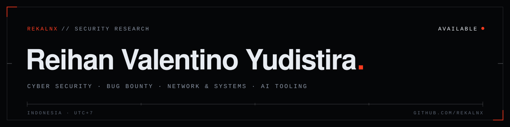

<picture>
  <source media="(prefers-color-scheme: dark)" srcset="assets/header-dark.svg">
  <source media="(prefers-color-scheme: light)" srcset="assets/header-light.svg">
  
</picture>

I'm a security engineer and bug hunter from Bogor, Indonesia. I test web apps, APIs and smart contracts and report what I find through coordinated disclosure. That work has earned a Letter of Recognition from NASA and 18 valid findings on HackerOne. I also build small, zero-dependency tools for Linux systems and AI agents, and I compete in robotics.

**Open to:** security engineering, network / sysadmin roles, and bug bounty or pentest engagements.

  
  
  
  
  
  

&nbsp;

### Security record

<picture>
  <source media="(prefers-color-scheme: dark)" srcset="assets/stats-dark.svg">
  <source media="(prefers-color-scheme: light)" srcset="assets/stats-light.svg">
  
</picture>

| Platform | Highlights |
| :-- | :-- |
| [HackerOne](https://hackerone.com/reivalentino?type=user) | **18** valid vulnerabilities · **12** thanks · Reputation **754** · Impact **23.64** (93rd percentile) · ID-verified |
| [NASA VDP](https://bugcrowd.com/nasa-vdp) | **Letter of Recognition**, received for a valid vulnerability reported through NASA's official Bugcrowd channel |
| [HackenProof](https://hackenproof.com/hackers/valentinoreihan) | Global rank **#1091** · Reputation **216** · 35 programs (NAVI Protocol, Cetus, Kaia…) · KYC-verified |
| [TTIS Kukar · CSIRT](https://ttis.kukarkab.go.id/whitehat-etam) | Hall of Fame entry for an XSS on a `kukarkab.go.id` subdomain, reported via the official CSIRT channel on 07 Dec 2025 |
| [Bugcrowd](https://bugcrowd.com/reivalentino) | Active researcher |

&nbsp;

### Now

- **Hunting** on HackerOne and HackenProof, mostly API authorization (BOLA, OAuth token flows) and sensitive-data exposure.
- **Building** zero-dependency tools in pure Python and POSIX shell for Linux isolation and AI agents.
- **Tinkering** with electronics, robotics and IoT, the hardware side I competed with at OTN 2024.

&nbsp;

### Selected work

| Project | What it does | Built with |
| :-- | :-- | :-- |
| [**nanobox**](https://github.com/rekalnx/nanobox) | Isolates Linux processes and filesystems with kernel namespaces in ~60 lines of shell. No Docker, no daemons. | POSIX sh |
| [**open-clinic-triage**](https://github.com/rekalnx/open-clinic-triage) | Offline emergency triage (START / JumpSTART, WHO Essential Medicines) that needs no internet. | Python · HTML/JS |
| [**ast-compress**](https://github.com/rekalnx/ast-compress) | Strips function bodies but keeps signatures and contracts, cutting LLM context by 84.1% on its own source. | Python |
| [**pure-agents**](https://github.com/rekalnx/pure-agents) | Implements 10 agent architectures (ReAct, Plan-and-Solve, Reflection, HTN…) using only the standard library. | Python |
| [**rewind**](https://github.com/rekalnx/rewind) | Lets you snapshot and restore any folder through SHA-256 content addressing, without git. | Python |
| [**agents-from-scratch**](https://github.com/rekalnx/agents-from-scratch) | Teaches the agent loop, tools, memory, RAG and multi-agent systems one chapter at a time. | Python |

&nbsp;

### Toolkit

**Offense** — web & API testing (BOLA, OAuth, injection), recon automation, Burp Suite, Solidity auditing 
**Systems** — Linux, kernel namespaces, Bash, Docker, networking, telecom fundamentals 
**Hardware** — electronics, robotics & IoT (OTN 2024 robotics competitor) 
**Build** — Python, JavaScript / TypeScript, AI agents & LLM tooling

&nbsp;

### Activity

<picture>
  <source media="(prefers-color-scheme: dark)" srcset="https://raw.githubusercontent.com/rekalnx/rekalnx/output/snake-dark.svg">
  <source media="(prefers-color-scheme: light)" srcset="https://raw.githubusercontent.com/rekalnx/rekalnx/output/snake-light.svg">
  
</picture>

Regenerated daily by a GitHub Action from my contribution calendar.

&nbsp;

### Contact

[LinkedIn](https://www.linkedin.com/in/reihan-valentino-y) · [HackerOne](https://hackerone.com/reivalentino?type=user) · [HackenProof](https://hackenproof.com/hackers/valentinoreihan) · [Bugcrowd](https://bugcrowd.com/reivalentino) · [Instagram](https://www.instagram.com/reivalentino)

Security findings are reported only through each organisation's official disclosure channel.
